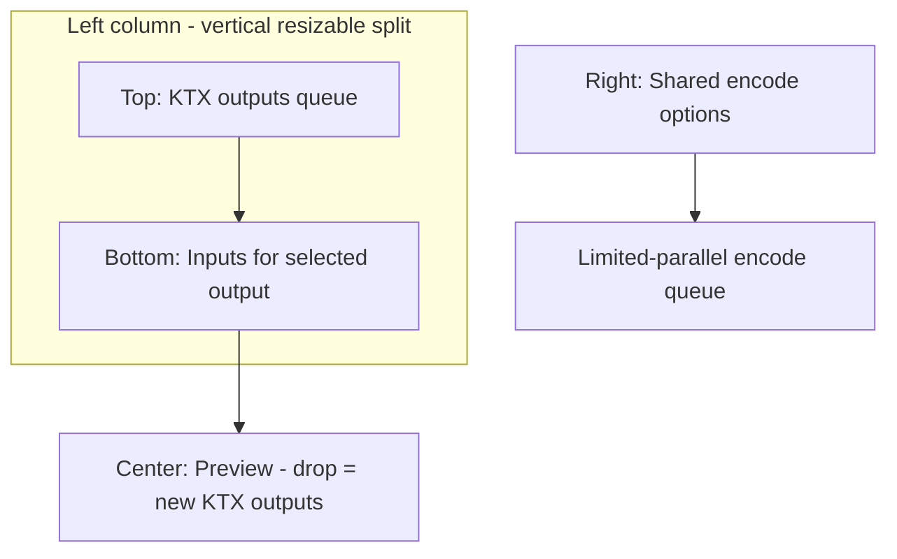

# Batch Outputs + Role-Typed Inputs — Product Plan

Long-lasting redesign of the encoder session. Not a smaller arity patch. Closes the open “batch vs single-KTX” note in [`docs/decision-context.md`](docs/decision-context.md).

## Problem

```
Provided 200 images, expected 1 (1 level × 1 layer × 1 face × 1 depth)
```

Today: one `SourceInfo[]` + one `CreateOptions` → one `ktx create`. The Sources panel looks like a batch queue but packs every file into one KTX. Rules never check source count vs shape.

## Target UX



| Zone | Role |
|---|---|
| **Top-left** | Batch queue of KTX **outputs**. Add button. Selectable rows. Scroll. Delete only (no reorder). Drop here → new outputs (one image → one output with a single input). |
| **Bottom-left** | **Inputs** for the selected output. Role selector (what the list means). Reorder arrows + delete. Drop here → append/replace inputs for that output only. |
| **Center** | Preview for the selected output. Drop here → same as top-left (new KTX outputs). |
| **Right** | **One shared** `CreateOptions` (+ animation when applicable) for every output in the queue. |

---

## Input role (bottom panel)

Bottom panel has a selector: **what this list means**. Exactly one role is active for the session (shared with options / container shape). List length **is** the arity; numeric `--layers` / face count / etc. are not typed by the user.

| InputRole | List meaning | Derived CLI | Other dims |
|---|---|---|---|
| `Base2D` (default) | Single base image | omit `--layers`, no `--cubemap`, omit `--depth` | Count must be **1** |
| `ArrayLayers` | Array layers (and anim frames) | `--layers = list.len()` | faces=1, depth unset |
| `CubemapFaces` | +X −X +Y −Y +Z −Z in order | `--cubemap`; count must be **6** | layers omitted (1) |
| `MipChain` | Explicit mip images (no generate-mipmap) | `--levels = list.len()`; generate-mipmap off/hidden | Count ≥ 1 |
| `DepthSlices` | 3D depth slices | `--depth` / slice count = `list.len()` per CLI rules; origin must allow front/back | layers omitted (1) |

**Layers rule (explicit):** If role is `ArrayLayers`, bottom list length **is** `--layers`. Otherwise `--layers` is omitted (effective 1). Never show a Layers number field in Container options.

Same pattern for the other roles: cubemap / levels / depth toggles and counts are **driven by the role + list**, not free numeric inputs. Conflicting Container controls are hidden or synced by Rust `describe_options` / suggestions (e.g. role `CubemapFaces` ⇒ cubemap on, top-left origin only; role `MipChain` ⇒ generate-mipmap off).

**Compound shapes** (cube arrays = layers × 6 faces, mip × layers, …) are **out of scope for v1**. One active input dimension at a time keeps arity = `list.len()` (or 6 for cubemap) and avoids a second nested list. Revisit later if needed.

**Per-output list, shared role:** Every output uses the same `InputRole`. Each output has its own `inputs: SourceInfo[]`. Adding an output that cannot satisfy the role (e.g. cubemap output with ≠6 images after drop) is rejected or the incomplete output cannot encode until the list is valid.

---

## Shared options + compatibility gate

**No** per-output options, **no** copy/paste, **no** apply-to-all.

- One `CreateOptions` + one `AnimationOptions | null` + one `InputRole` for the whole session.
- New KTX output (button or drop on top/center) is **rejected** if incompatible with the **first** output already in the queue (toast with reason).
- Compatibility (Rust-owned), at minimum:
  - Same `SourcesClass` (LDR vs HDR); mixed forbidden across the queue.
  - New files must be valid as a `Base2D` seed (or whatever default slot) under current shared options / role — e.g. cannot add EXR while format/options assume LDR.
- Changing shared options runs `describe_options` once; suggestions apply once to the shared struct. Encode validates each output’s inputs against that shared shape.

Empty queue: first add always accepted; it pins the session class (LDR/HDR) and default role `Base2D` unless the user already changed role on an empty selection (role still shared).

---

## Drag-and-drop (exact meanings)

| Drop target | Effect |
|---|---|
| Top-left (outputs) | Each image → new KTX output with one input. Reject whole drop or individual files that fail the compatibility gate. |
| Bottom-left (inputs) | Append (or add) to the **selected** output’s input list, interpreted by current `InputRole`. Enforce role arity (e.g. cubemap max 6; Base2D replace/single). |
| Center (preview) | Same as top-left: new KTX outputs. |
| Elsewhere / chrome | Prefer same as center (new outputs), or ignore — do **not** silently append to layers. |

Visual drop affordances must differ (label + highlight) so batch vs pack cannot be confused again.

---

## Encode / cancel / save + queue modal

- **Encode** (menu/button): encode all outputs that have valid input lists (or “encode selected” as a secondary if useful; primary is batch).
- **Limited parallelism:** run up to `min(N, threads_cap)` jobs at once (cap e.g. 2–4 or `available_parallelism` bounded — pick a small constant in implementation, expose later only if needed). Rest wait in queue.
- **Queue modal** while a batch runs:
  - Progress text: `Done i / N` (and optional current file name).
  - Per-item status optional (pending / running / done / error).
  - **Cancel queue** stops starting new jobs and cancels in-flight via existing `CancellationHandle`s.
- Partial success: keep successful job results; failed items show error; user can re-encode failures after fix.
- **Save:** selected output, or save-all to a directory (names from each output’s primary input stem).
- Menu enablement: Clear clears outputs (and inputs); Encode/Cancel/Save track queue state.

---

## Animation (not secondary — tied to role)

Animation is first-class when packing frames, not a rival to batch:

1. Set **InputRole = ArrayLayers** on the bottom panel.
2. Select (or create) one KTX output; drop/reorder frame images in the bottom list (count ⇒ `--layers`).
3. **Animation** section in the shared options rail enables when role is `ArrayLayers` and the **selected** output has ≥ 2 inputs (same gate as today, but scoped).
4. On encode, every output with a valid layer list gets `--layers = inputs.len()`. If animation is enabled, Rust writes the same shared `KTXanimData` onto each encoded file that has ≥ 2 layers (batch of identically timed arrays is supported; single-frame outputs in that queue are rejected by validation while anim is on, or anim requires all outputs ≥ 2 layers — prefer **refuse encode** if anim on and any output has `< 2` inputs).

Batch of 200 independent albedos: leave role at `Base2D`, drop on top/center → 200 outputs × 1 input. Animation stays hidden/disabled.

---

## Preview + `describe_options` (discretion)

**describe_options**

- Still one shared options object → **one** debounced `describe_options` call.
- Pass sources = concatenation is wrong for class; pass **union check via first output + spot-check**, or a dedicated `sources` sample: all primary inputs’ kinds for class, and selected output’s full list for any list-sensitive warnings.
- Arity validation is separate: `validate_output(role, inputs, options)` per output at encode and when the bottom list changes (enable Encode only if every queued output is valid, or allow encode-all to skip invalid — prefer **block Encode** until all valid or user removes bad rows).

**Preview memory**

- Viewer binds to **selected** output: compare wipe = that output’s primary input (`inputs[0]` or face0) vs that output’s encoded preview when its job is done.
- Keep at most: selected output’s source preview URL + selected encoded URL; revoke object URLs when selection changes.
- Job workdirs/previews on disk can remain until Clear / app exit; do not pin 200 decoded bitmaps in the webview.
- Switching selection shows cached disk preview via existing `encoded_preview(jobId)` when present (lazy fetch).

---

## Layout

Left column of the existing horizontal resizable split becomes a **vertical resizable split** (two rows):

1. Top row — Outputs queue  
2. Bottom row — Inputs + role selector  

Persist sizes with the same `auto-save-id` pattern as today. This is intentional chrome, not a drawback.

---

## Data model (encoder store)

```ts
// Conceptual — shared session + per-output slots
InputRole = "base2d" | "arrayLayers" | "cubemapFaces" | "mipChain" | "depthSlices"

OutputSlot = {
  id: string
  inputs: SourceInfo[]  // interpreted by session inputRole
  job: JobState         // idle | queued | running | done | error
}

store = {
  outputs: OutputSlot[]
  selectedId: string | null
  inputRole: InputRole
  options: CreateOptions      // shared
  animation: AnimationOptions | null  // shared
  report: OptionReport        // shared describe_options result
  queue: BatchQueueState | null  // modal: total, done, cancel requested
}
```

Rust encode request gains `outputId` (or one request per slot). Shared options cloned into each `EncodeRequest`. `--layers` / `--cubemap` / `--levels` / `--depth` filled from `inputRole` + that slot’s `inputs.len()` in argv building (not from manual Container fields).

Remove UI fields: Container `layers` (and any other arity numbers superseded by role). Keep unrelated container flags (1d, scale, width/height, generate-mipmap when role allows).

---

## Main touch points

| Area | Paths |
|---|---|
| Store / actions / menu | [`src/encoder/store.ts`](src/encoder/store.ts), [`actions.ts`](src/encoder/actions.ts), [`menuBridge.ts`](src/encoder/menuBridge.ts) |
| Layout / lists | [`EncoderApp.vue`](src/encoder/EncoderApp.vue), replace/split [`SourceList.vue`](src/encoder/components/SourceList.vue), new OutputsQueue + InputsPanel |
| Preview / encode bar | [`PreviewPane.vue`](src/encoder/components/PreviewPane.vue), [`EncodeBar.vue`](src/encoder/components/EncodeBar.vue), new QueueModal |
| Options | [`ContainerSection.vue`](src/encoder/components/options/ContainerSection.vue), [`AnimationSection.vue`](src/encoder/components/AnimationSection.vue) |
| Rules / argv / encode | [`rules.rs`](src-tauri/src/ktx/rules.rs), [`create_args.rs`](src-tauri/src/ktx/create_args.rs), [`encode.rs`](src-tauri/src/commands/encode.rs), drag-drop classification |
| Docs | [`requirements.md`](docs/requirements.md), [`decision-context.md`](docs/decision-context.md) |

---

## Advantages (retained)

- Clears batch-vs-pack ambiguity permanently.
- Arity is structural (role + list length) → no more “200 images for 1×1×1×1”.
- Shared options keep the rules engine and UI simple (one form).
- Compatibility gate at add-time prevents mixed LDR/HDR / invalid seeds in the queue.
- Limited-parallel + queue modal matches a 200-file batch without freezing the UI or spawning 200 processes.
- Animation stays obvious: switch role to ArrayLayers, add frames, enable Animation.

## Costs (accepted)

- Session rewrite (outputs collection + shared options + queue state).
- DnD routing and role-driven Container field hiding.
- Batch orchestration (parallelism cap, modal, cancel, partial failure, save-all).
- Docs / decision log update; product wording change in requirements Encoder section.

## Out of scope (v1)

- Per-output options, copy/paste, apply-to-all.
- Compound input dimensions (cube arrays, mip×layer products).
- Smaller “just auto-set --layers” patch as a substitute.

---

## Bottom line

Ship the split queue: **outputs (top) + role-typed inputs (bottom)**, **shared options** with reject-on-incompatible-add, **center/top drop = new outputs**, **limited-parallel encode** with a **Done i/N + Cancel queue** modal, animation gated on **ArrayLayers**. That is the durable fix for the mental model and for known-invalid `ktx create` arities.
