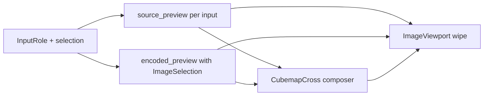

# Preview: role-aware inputs, cubemap cross wipe, generated mips

## Product rules (locked)

| `InputRole` | Before encode | After encode |
|---|---|---|
| `base2D` | Single source preview | Wipe source vs encoded L0; **add Mip slider** if `EncodeResult.levels > 1` |
| `arrayLayers` | **Layer** slider over inputs | Wipe `inputs[layer]` vs extract `(level, layer)`; **add Mip slider** if levels > 1 |
| `mipChain` | **Mip** slider over inputs | Wipe `inputs[level]` vs extract `(level)` (generate-mipmap already off) |
| `cubemapFaces` | Classic **cross** of up to 6 inputs (empty slots if incomplete) | Same cross geometry; **one wipe** over the whole net (source cross vs encoded cross); **add Mip slider** if levels > 1 |
| `depthSlices` | **Depth** slider over inputs (2D slice only) | Wipe slice vs extract; mips N/A (3D + generate-mipmap invalid) |

- Preview always starts from **inputs**; encode never required for role browsing.
- Wipe always compares **input side vs output side in the same frame** (existing [`ImageViewport`](src/shared/components/ImageViewport.vue) compare mode).
- Generated mips (post-encode only): scrubbing mip `N` keeps the **full-res input(s)** on the left and the **extracted mip N** on the right so the wipe shows resolution/quality loss.
- CSS3D depth volume is **out of scope** here — see follow-up plan.

## Architecture



### Rust

- Extend [`encoded_preview`](src-tauri/src/commands/encode.rs) to take `ImageSelection` (camelCase IPC). Resolve job `output_path` + `preview-cache` (already created at encode); call existing [`extract_preview_png`](src-tauri/src/ktx/extract_ops.rs) like [`inspector_image`](src-tauri/src/commands/inspect.rs). Keep writing L0 cache during encode for the first paint.
- Stash `TextureMeta` (or at least `Dims`) on [`Job`](src-tauri/src/state.rs) at encode finish so the UI knows `levels` / `faces` / `layers` / depth without re-running info.
- No new sidecar features; reuse extract + disk PNG cache naming.

### Vue — PreviewPane

Rewrite [`PreviewPane.vue`](src/encoder/components/PreviewPane.vue) around selection state keyed by selected output id:

- `previewIndex` — layer / mip-chain / depth index into `inputs` (role-dependent).
- `encodedMip` — only when job done and `result.levels > 1` (and role is not `mipChain`, where the input slider already is the mip axis).
- Load source URL(s) via `source_preview` for the active input(s).
- Load encoded URL(s) via `encoded_preview({ jobId, selection })` when done.
- Reuse inspect-style range + tick labels ([`MipStrip`](src/inspector/components/viewer/MipStrip.vue) / [`RangeTickLabels`](src/inspector/components/viewer/RangeTickLabels.vue)); prefer small shared controls under `src/shared/` rather than importing inspector store.

### Cubemap cross + single wipe

New helper (e.g. `src/encoder/cubemapCross.ts` + thin Vue wrapper):

- Classic net (KTX face order `+X −X +Y −Y +Z −Z`):

```text
      +Y
  −X  +Z  +X
      −Y
      −Z
```

- Draw/composite six face bitmaps into **one** canvas (fixed cell size = max face edge), produce a blob URL for the source net and one for the encoded net.
- Pass those two URLs into `ImageViewport` as `src` / `compareSrc` so **one** wipe handle compares the entire cross.
- Incomplete faces (count ≠ 6): leave cells empty/checker; still allow browse before arity is valid.
- When `encodedMip > 0`, source net stays full-res faces; encoded net uses extracts at that level (cells share the same grid; upscale-in-cell via canvas draw so nets align for wipe).

### Generated-mip wipe (non-cubemap)

- Left: current role’s source image at `previewIndex` (full res).
- Right: extract with `level: encodedMip` (+ layer/depth from selection).
- `contentWidth` / `contentHeight` from header>>mip when known so fit matches inspect.

### DepthSlices (this plan)

- Same as array layers but index → `depthSlice` / input list; single 2D wipe. No volume UI.

## Docs

- Update [`docs/requirements.md`](docs/requirements.md) Encode preview section: role-aware preview, cubemap cross wipe, generated-mip slider.
- Append dated entry to [`docs/decision-context.md`](docs/decision-context.md).

## Out of scope

- CSS3D depth volume (follow-up plan).
- Cube arrays / compound shapes.
- Changing inspect UI (already has per-face buttons; encoder uses cross instead).
